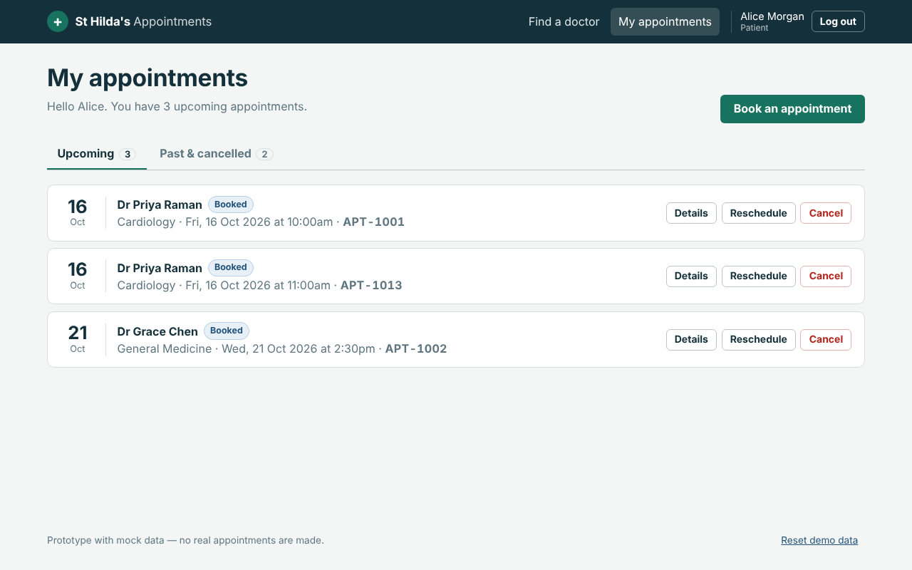

# Hospital Appointment Booking System

Business analysis assessment: requirements, user flows, wireframes, a clickable React prototype and executed test cases for a web app that lets patients find doctors, book, cancel and reschedule appointments, while doctors manage their availability and administrators oversee bookings.

**Author:** Archana Jangamgunta · **Built with:** Claude (analysis, design, code, tests, documentation) and GitHub (version control, hosting)



## Deliverables

| Deliverable | Where | Notes |
|---|---|---|
| Business Requirement Document | [docs/BRD.md](docs/BRD.md) · [BRD.docx](docs/BRD.docx) | Objectives, scope, stakeholders, 50+ FRs, 16 business rules, 15 user stories with acceptance criteria, NFRs, gap analysis, assumptions, traceability |
| User flow diagrams | [docs/user-flows](docs/user-flows/README.md) | Patient, doctor, admin and access-control flows (Mermaid + PNG), appointment lifecycle |
| Wireframes (8 screens) | [docs/wireframes](docs/wireframes/README.md) | Annotated low-fi wireframes linked to requirement IDs |
| Clickable prototype | [prototype/](prototype/README.md) | React 19, mock data, responsive. Open `prototype/dist/index.html` directly or run `npm run dev` |
| Test case sheet | [docs/testing/test-cases.xlsx](docs/testing/test-cases.xlsx) | 38 cases with ID, scenario, preconditions, steps, data, expected, actual and status — **38 / 38 passed** |
| Presentation | [docs/presentation/presentation.pptx](docs/presentation/presentation.pptx) | 12 slides: business logic, design decisions, assumptions, testing, workflow |
| Screenshots | [docs/screenshots](docs/screenshots) | Every main screen of the prototype |

## Try the prototype

**Quickest:** download the repo and open `prototype/dist/index.html` in a browser — no install needed.

**Or run it locally** (Node 20+):

```bash
cd prototype
npm install
npm run dev        # http://localhost:5173
npm test           # 14 business-rule unit tests
npm run test:e2e   # 38 browser test cases (after: npx playwright install chromium && npm run build)
```

A GitHub Actions workflow (`.github/workflows/pages.yml`) publishes the prototype to GitHub Pages on every push to `main` (enable *Settings → Pages → Source: GitHub Actions* once).

### Demo accounts

| Role | Email | Password |
|---|---|---|
| Patient | alice@demo.com | Patient@123 |
| Patient | ben@demo.com / chloe@demo.com | Patient@123 |
| Doctor | priya.raman@hospital.demo | Doctor@123 |
| Admin | admin@hospital.demo | Admin@123 |

The login page has one-click buttons for these. **Reset demo data** in the footer restores the seed data.

### What to try

1. **Patient journey** — Find a doctor → Cardiology → Dr Priya Raman → pick a free slot → log in → confirm → see the confirmation and My appointments.
2. **Double booking** — booked times are struck through and can't be selected. On the review screen, *Demo tools → Another patient books this slot* shows the re-check on confirm.
3. **Cancel / reschedule** — from My appointments. The cancelled slot is immediately bookable again; changes are blocked within 2 hours of the start.
4. **Doctor** — Schedule (mark completed only after the start time; cancel with a reason) and Availability (click a time to publish or remove it; booked times are locked).
5. **Admin** — Overview, filter and manage all appointments, add/edit/deactivate doctors, deactivate patients, reports with CSV export.
6. **Access control** — as a patient, open `#/admin`: you are sent back to your own dashboard.

## Key business logic

A slot can be booked only if it is **published** by the doctor, **in the future** (within 30 days, on the half hour) and **not held by a Booked appointment**. Availability is derived from appointments rather than stored separately, so cancelling or rescheduling releases the slot automatically and the two can never drift apart. All rules live in [`prototype/src/lib/rules.js`](prototype/src/lib/rules.js) as pure functions used by the UI and the tests; error messages carry the BRD rule ID (e.g. *BR-02*).

Rules added during analysis (BRD §11): 30-minute slots 09:00–16:30, 30-day horizon, 2-hour change cut-off, no patient self-clash, booked slots can't be removed, complete only after start time, reschedule keeps the doctor, max 3 upcoming appointments.

## Repository structure

```
├── docs/
│   ├── BRD.md / BRD.docx          Business Requirement Document
│   ├── user-flows/                Mermaid sources + PNG exports
│   ├── wireframes/                wireframes.html + 8 PNGs
│   ├── testing/                   test-cases.xlsx, results.json, sheet builder
│   ├── presentation/              presentation.pptx + build script
│   └── screenshots/               prototype screenshots
├── prototype/
│   ├── src/
│   │   ├── lib/                   rules.js (business rules), store.jsx (state), router, dates
│   │   ├── data/mockData.js       seed doctors, patients, availability, appointments
│   │   ├── components/            layout, slot picker, shared UI
│   │   └── pages/                 auth, doctors, patient, doctor and admin dashboards
│   ├── tests/                     rules.test.js (unit), e2e.mjs (38 browser cases)
│   ├── dist/                      built prototype — open index.html
│   └── build.mjs                  esbuild build / dev server
└── .github/workflows/pages.yml    deploy prototype to GitHub Pages
```

## Assumptions and limitations

- Mock data only: data is kept in the browser's local storage and the rules run in the browser. A production build must enforce the same rules on the server with a unique constraint on doctor + slot start (NFR-03).
- Notifications are shown as on-screen messages; email/SMS delivery is out of scope.
- Full assumptions are in [BRD §12](docs/BRD.md#12-assumptions).
