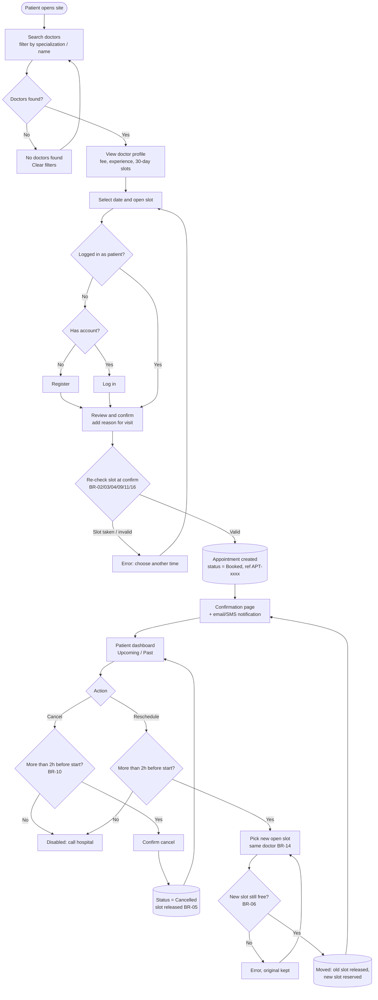
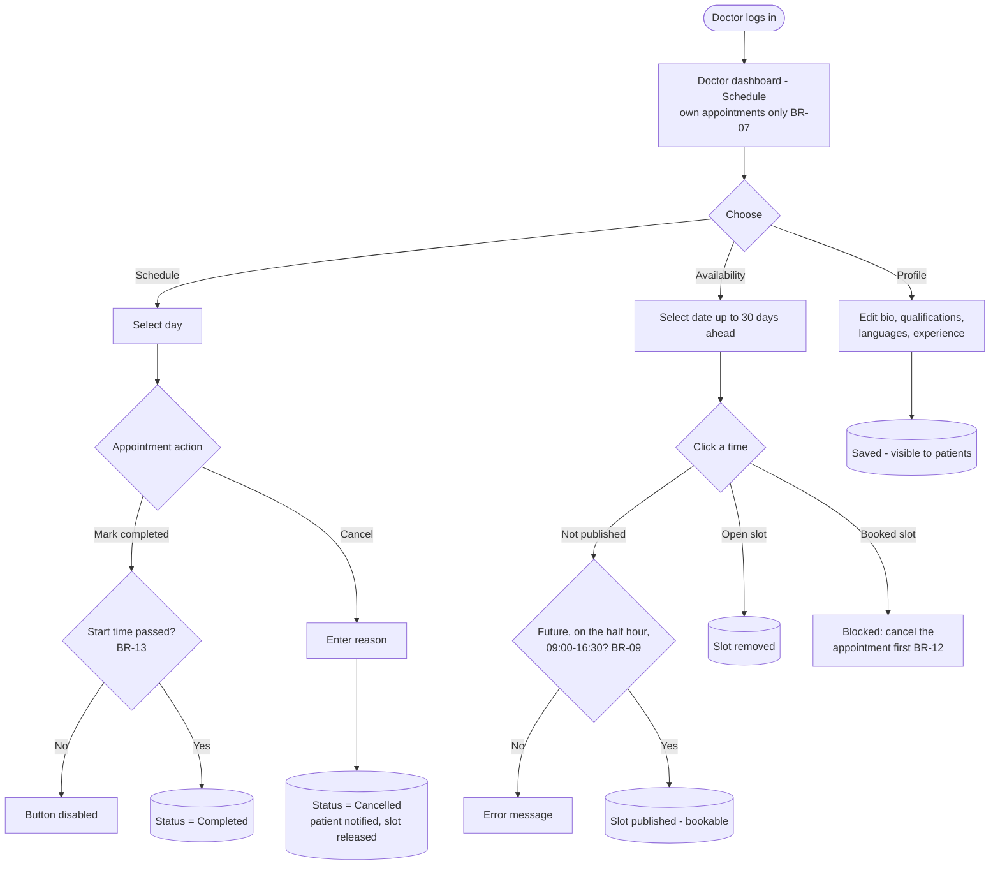
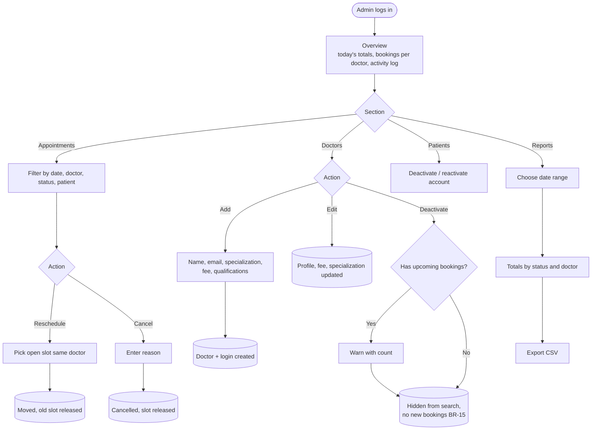
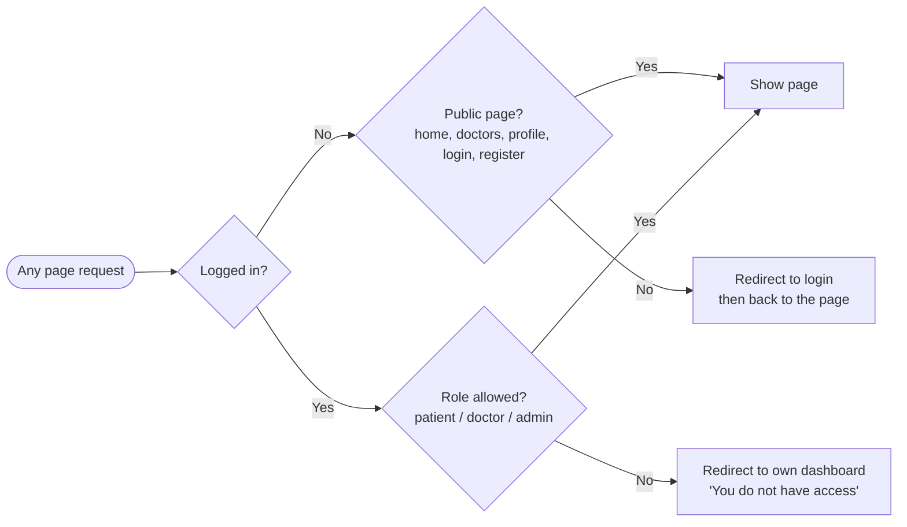
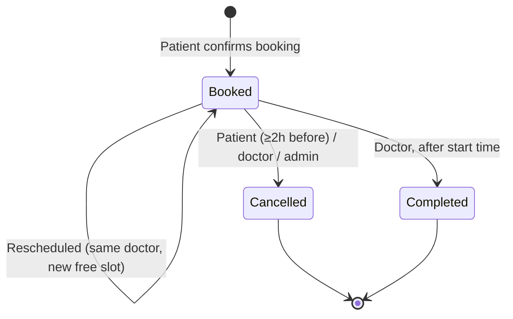

# User flows

Flow diagrams are written in Mermaid (rendered automatically by GitHub below) with PNG exports alongside. Business-rule IDs (BR-xx) refer to [BRD section 7](../BRD.md#7-business-rules).

| Flow | Source | Image |
|---|---|---|
| Patient: search → book → confirm → cancel / reschedule | [patient-booking.mmd](patient-booking.mmd) | [patient-booking.png](patient-booking.png) |
| Doctor: schedule, availability, profile | [doctor.mmd](doctor.mmd) | [doctor.png](doctor.png) |
| Administrator: appointments, doctors, patients, reports | [admin.mmd](admin.mmd) | [admin.png](admin.png) |
| Role-based access check on every page | [rbac.mmd](rbac.mmd) | [rbac.png](rbac.png) |

## 1. Patient booking journey

## 2. Doctor

## 3. Administrator

## 4. Role-based access

## Appointment status lifecycle

