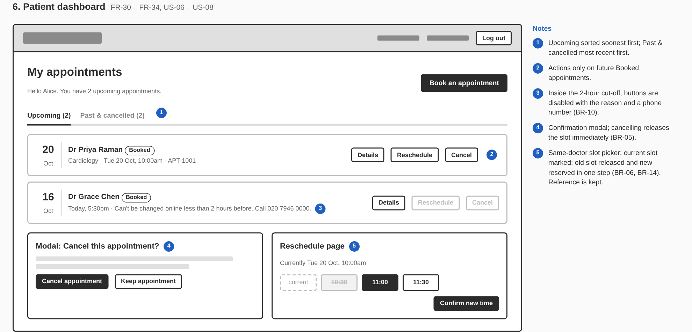

# Wireframes

Low-fidelity wireframes for the eight screens in Task 2, produced with Claude as an HTML wireframe kit ([wireframes.html](wireframes.html) — open in a browser) and exported to PNG. Numbered markers link to design notes and BRD requirement IDs.

| # | Screen | Requirements |
|---|---|---|
| 1 | [Login and registration](01-login-registration.png) | FR-01 – FR-08 |
| 2 | [Doctor listing and search](02-doctor-search.png) | FR-10 – FR-12 |
| 3 | [Doctor profile and slot selection](03-doctor-profile.png) | FR-13, FR-14 |
| 4 | [Appointment booking](04-booking.png) | FR-20, FR-21, FR-25 |
| 5 | [Appointment confirmation](05-confirmation.png) | FR-22, FR-23 |
| 6 | [Patient dashboard (incl. cancel and reschedule)](06-patient-dashboard.png) | FR-30 – FR-34 |
| 7 | [Doctor dashboard (schedule and availability)](07-doctor-dashboard.png) | FR-40 – FR-46 |
| 8 | [Admin dashboard](08-admin-dashboard.png) | FR-50 – FR-57 |

## Design decisions

- **Slots are the centre of the design.** Every booking-related screen shows time slots in one consistent form: open (selectable), booked (struck through, disabled), passed (dashed). Patients can't pick an unavailable slot, which prevents most double-booking errors before the server check.
- **Rules are visible, not hidden.** Where a rule blocks an action (2-hour cut-off, booked slot can't be removed, complete only after start) the button is disabled and the reason is shown next to it.
- **One login, role-based landing.** Patients, doctors and admins share a login page and land on their own dashboard.
- **Guest browsing.** Search and profiles are public so patients can compare doctors before registering; login is asked for only at the booking step and returns them to their chosen slot.
- **Mobile first-class.** All layouts collapse to one column; the date strip scrolls horizontally on phones.

